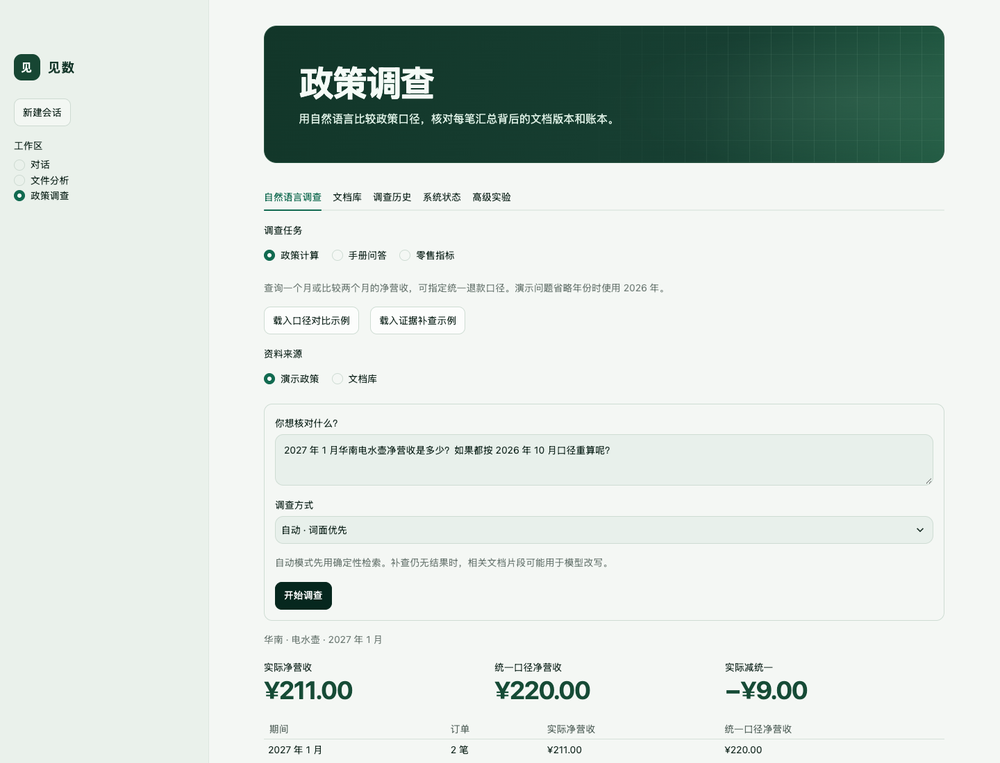
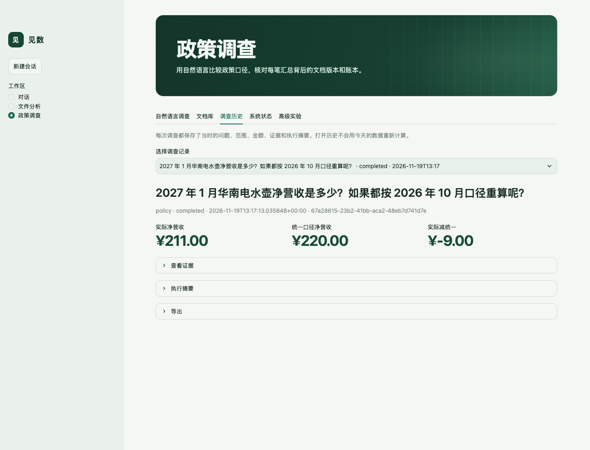

# 见数 · Evidence-gated Agentic RAG

> 把自然语言问题变成**可复算的数字**或**有出处的答案**，并保留版本、引用、SQL、边界和拒答。

一个面向 **政策调查 / 产品手册 / 零售指标** 的垂直 Agentic RAG 工作台。

不是通用聊天机器人，也不是只生成 SQL 的 Text2SQL。

[三分钟演示视频](examples/demo/v3-portfolio-demo.mp4) · [作品集案例](docs/portfolio-case-study.md) · [简历描述](docs/resume-bullets.md) · [面试表达](docs/interview-guide.md)



## 为什么做这个

普通 Text2SQL 能算数，但不一定知道：

- 用哪一版政策；
- 哪份公告在生效；
- 退款用订单表还是售后台账；
- 同一个问题在 10 月和 11 月口径不同；
- 证据不足时该不该拒答；
- 结果能不能回到原文核对。

普通 RAG 能给一段话，但算不出数字，也不容易审计金额。

见数把两条链路接在一起：

```text
问题
→ 范围解析
→ 政策 / 公告 / 手册检索
→ 证据缺口判断
→ 词面补查 / 模型兜底 / 拒答
→ 只读 SQL 或手册章节
→ 金额与引用核验
→ 历史 / 导出 / 权限 / 观测
```

## 实测指标

内部 150 题多域评测（policy 60 / manual 45 / retail 45）：

| 指标 | 结果 |
| --- | --- |
| 模型兜底通过 | **150 / 150** |
| 离线确定性通过 | 146 / 150 |
| 错误出数 | **0** |
| Doc Recall | **100%** |
| Citation precision | **100%** |
| 拒答正确率 | **100%** |
| 正常路径 P95 | **4.45 ms** |
| 模型兜底 P95 | **1002.51 ms** |
| 自动测试 | **301** |

说明：4 道 buried-backlink 题需要模型补查。完整报告见 [M5 发布评测](docs/v3-m5-release-report.md)。

## 能做什么

### 政策调查

- 单月跨口径：2027 年 1 月实际 ¥211.00，按 2026 年 10 月口径 ¥220.00，实际减统一 −¥9.00。
- 双月对比与方向：10 月比 11 月高 ¥46.40，统一口径高 ¥40.80。
- 冲突 / 公告循环 / 部分月份缺证据：无金额，SQL 0。
- 每条金额可回到政策、公告、账本、SQL 和绑定参数。

### 产品手册

- Markdown / HTML / PDF / DOCX 版本化上传。
- PDF 页级定位，DOCX 段落级定位。
- v1 蓝灯 / v2 绿灯版本差异。
- 不支持的问题明确说“缺证据”，不硬答。

### 零售指标

- 净营收 / 订单数 / 退款额 / 客单价。
- 只读 SQL、无模型调用。
- 同一入口进入政策、手册、零售三个 domain。

### 工作台

- 调查历史与回放。
- Markdown 调查报告 + CSV 金额明细。
- 文档解析预览、版本、ACL。
- 追问通过 investigation ID 关联父调查。
- 系统状态 / 结构化观测 / 并发有界拒绝。

## 架构

```text
Streamlit
  ↓
FastAPI /api/v3/*
  ↓
Domain Registry
  ├─ policy
  ├─ manual
  └─ retail
  ↓
app/rag
  ├─ Markdown / HTML / PDF / DOCX ingestion
  ├─ heading/page/paragraph chunking
  ├─ BM25 + metadata + ACL
  ├─ optional dense / RRF / rerank
  └─ Evidence / citation
  ↓
Policy: 政策 + 公告 + 账本 + 只读 SQL
Manual: 章节匹配 + 版本引用
Retail: 订单聚合 + 只读 SQL
  ↓
Verifier / History / Export / Metrics
```

设计取舍：

```text
Evidence-gated，不是自由 ReAct
有界状态机，不是 Multi-Agent
垂直 domain pack，不是通用平台
正常路径 0 模型调用，模型只用于补查
```

## 快速启动

需要 Docker Desktop 或 Compose v2.24+。

```bash
git clone https://github.com/15016623369a-spe/jianshu-react.git
cd jianshu-react

cp .env.example .env
# 编辑 .env：LLM_API_KEY、LLM_BASE_URL、LLM_MODEL

docker compose up -d --build --wait
```

打开：

- UI：http://127.0.0.1:28501/?workspace=policy-exploration
- API：http://127.0.0.1:28000/docs
- 状态：http://127.0.0.1:28000/api/v3/status

离线确定性路径不需要模型 key；配置模型后才启用模型补查。

## 演示

视频：[examples/demo/v3-portfolio-demo.mp4](examples/demo/v3-portfolio-demo.mp4)

三分钟演示顺序：

```text
1. A1 单月跨口径
2. 词面补查
3. 版本变化
4. 冲突 / 循环拒答
5. 引用审计
6. 手册蓝灯 / 绿灯
7. 历史与导出
8. 系统状态
```

详细话术：[演示 Runbook](docs/v3-m6-demo-runbook.md)



## 评测与复现

```bash
# 150 题离线：146/150
PYTHONPATH=. .venv/bin/python -m evaluation.run_m5_gate \
  --output evaluation/results/m5_gate_offline.json

# 150 题模型兜底：150/150
PYTHONPATH=. .venv/bin/python -m evaluation.run_m5_gate --model \
  --output evaluation/results/m5_gate_model.json

# 单元测试
PYTHONPATH=. .venv/bin/python -m unittest discover -s tests
```

更多：

- [M5 评测说明](docs/v3-m5-evaluation.md)
- [M5 发布报告](docs/v3-m5-release-report.md)
- [M4 验收](docs/v3-m4-acceptance.md)
- [文档格式与检索](docs/v3-m4-ingestion-hybrid.md)
- [生产 HTTPS 冒烟](docs/v3-m6-release-record.md)

## 项目结构

```text
app/
  product_api.py          FastAPI 入口
  product_ui.py           Streamlit 工作台
  investigation_v3.py     共享调查/证据
  investigation_history.py 调查记录
  policy_investigation.py 政策口径
  policy_investigation_retrieval.py 政策检索
  retail_investigation.py 零售指标
  rag/                    通用 ingestion / retrieval / evidence
  observability.py        无内容结构化日志
evaluation/
  run_m5_gate.py          150 题 gate
  m5/                     多域题集
  results/                评测结果
scripts/
  state_backup.py         状态备份/恢复
  policy_release_smoke.sh 生产 HTTPS 冒烟
docs/
  portfolio-case-study.md 作品集案例
  interview-guide.md      面试表达
  ...
```

## 这是什么，不是什么

这是：

```text
垂直政策 / 手册 / 零售 Agentic RAG
受控、证据驱动、可审计
内部 150 题评测
生产配置 HTTPS 冒烟
```

这不是：

```text
通用 Agentic RAG 平台
任意 PDF / 任意数据库
真实外部试点验证过的产品
第三方独立评测
生产 SaaS
```

当前分支：`v3-foundation`。`v2.0.0` 保留为检查点。

## 来源

从 [见数 Text2SQL Agent `43b151a`](https://github.com/15016623369a-spe/text2sql-agent/commit/43b151aa4505e3bb98acdfa19a30e8b6fceb2ccb) 派生，保留原有数据库问数、文件分析和批准流程，并在此基础上实现 V3 调查工作台。

## 许可

[MIT License](./LICENSE) © 2026 Jace Huang（黄晖杰）。
